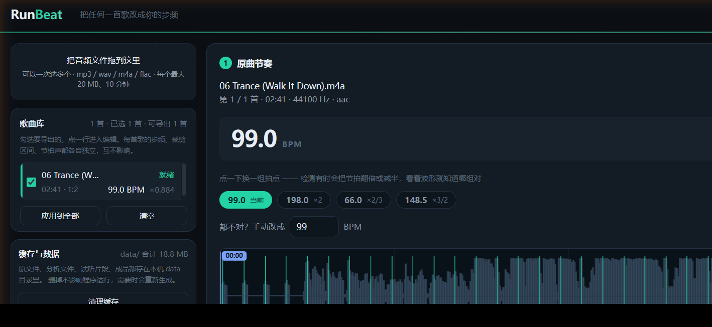
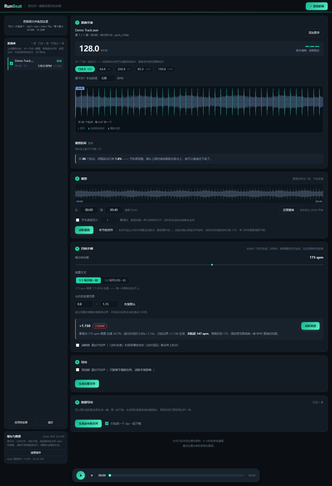

# RunBeat

**为跑者做的跑步音乐生成器**：把任意一首歌改成**你的步频** —— 每一步踩在一拍上，音高不变。

[](LICENSE)
[**English**](README_EN.md) | **中文**

跑步听歌最扫兴的事莫过于节奏和脚步打架：歌是好歌，可它的速度不由你。步频 170~180 spm（每分钟步数）是多数跑者的舒适区，但市面上的歌很少正好落在这个速度上。RunBeat 做的事很简单：检测原曲速度，按你的目标步频把整曲时间轴拉长或压短 —— 脚步踩在鼓点上，音高一点不动，你听到的还是那首歌。

做法是整曲时间伸缩（time-stretch），不重排拍点、不掺合成器、不动音高。

---

## 下载即用（Windows）

**下载地址**：<https://github.com/chenllsu/RunBeat/releases/latest> → 下载 `RunBeat-win64.zip`（约 130 MB）

1. **先解压** —— 必须解压成文件夹后再运行，**不要在压缩包里直接双击**，那样程序起不来
2. 双击文件夹里的 **`RunBeat.exe`**，弹出应用窗口（关掉窗口即为退出）
3. 把想改的歌拖进窗口 → 调到你想要的步频 → 生成下载

几个提前知道的事，能省掉不少「以为坏了」：

| 情况 | 说明 |
|---|---|
| **第一首歌要等 1~2 分钟** | 程序在后台编译音频引擎，属于一次性开销。**第二首起每首只需 1 秒左右**，界面会有提示 |
| 文件存在哪 | 存在程序文件夹里的 `data/` 子目录。**整个文件夹可以拷到 U 盘或另一台电脑接着用** |
| 联网吗 | **变速功能完全在本机处理，不上传任何文件。** 只有用「搜歌下载」时才会访问 Apple Music 获取你要下载的那首歌 |
| 遇到问题 | 把 `data/logs/runbeat.log` 发出来就能定位 |
| 被安全软件拦 | 未签名的自打包程序偶发误报，选择「仍要运行」即可；不放心可自行从源码构建 |

> **别把文件夹放在 `C:\Program Files`** 这类需要管理员权限的位置 —— 程序要在自己旁边建 `data/` 存文件用。
> 放桌面、文档、D 盘都可以。系统要求：**64 位 Windows 10 及以上**。

---

## 能做什么

**变速核心**

- **上传**：mp3 / wav / m4a / aac / flac / ogg / opus / wma，单文件 ≤ 20 MB、时长 ≤ 10 分钟
- **检测原曲 BPM**：自动检测并**自动纠正半速 / 倍速误判**，附可信度分档；仍给一组候选值（±2x、2/3x、3/2x）一键切换，都不对可直接手填
- **核对拍点**：示波器叠画波形、拍点线、播放头；「听节拍对齐」播**原速原曲 + click**，用来确认检测准不准
- **裁剪区间**：在整曲波形上拖两个手柄选一段，松手**自动对准最近鼓点**（最多挪半拍）；也可直接填 `1:20`，不选就是整首
- **设定目标步频**：120~220 spm（默认 175），1:1（每步踩一拍）与 1:2（每两步踩一拍）两种换算
- **限制变速幅度**：自设 `min~max` 倍率，超出的截到边界并回显实际步频
- **试听**：浏览器实时变速、零延迟，可叠节拍声，改步频时正在播的音频自动跟上
- **生成下载**：服务端完整渲染（音质比试听好），可叠节拍声
- **批量处理**：一次上传多首（≤ 20 首），每首独立调参、独立试听；可「按第一首应用到全部」，最后一键打包 zip

**在线音源**

点顶栏「⌕ 搜歌下载」，按歌名 / 歌手搜索 Apple Music 曲库，三列网格每页 12 首、纯翻页。
点「下载」自动完成 下载 → BPM 检测 → 入歌曲库，全程有分阶段进度提示。下载完的歌和手动上传的**完全等价**，后续变速 / 导出流程通用。

- 需要 Apple Music **有效订阅**：首次使用在「音源设置」里粘贴浏览器导出的 cookies（三步引导）
- 曲名按 `歌名-歌手` 自动规范；凭证只存本机 `data/cookies.txt`，不上传
- 无 cookies 也能搜索浏览，只在点下载时才需要凭证

---

## 从源码运行（开发者）

> 只想用软件的话，直接看上面的「下载即用」，不用装任何环境。

需要 **64 位 Python 3.10+**（librosa 依赖 64 位，32 位装不上）。

```bash
# 1. 创建虚拟环境
python -m venv .venv

# 2. 安装依赖（官方源慢可换镜像）
.venv/Scripts/python.exe -m pip install --isolated \
  -i https://mirrors.aliyun.com/pypi/simple/ \
  -r requirements.txt
```

Windows 下双击 `run.bat`，或手动启动：

```bash
.venv/Scripts/python.exe -m uvicorn app.main:app --host 127.0.0.1 --port 8000
```

然后打开 <http://127.0.0.1:8000>。开发时用 `run-dev.bat`（改代码自动重载）。

**关于 ffmpeg**：项目通过 `imageio-ffmpeg` 自带 ffmpeg 二进制，**不需要手动安装**。
想用自己那份，设置环境变量 `RUNBEAT_FFMPEG` 指向可执行文件即可。

> 装依赖时若遇到 `Could not find a version that satisfies the requirement ... (from versions: none)`，
> 通常是代理或镜像的问题：先 `unset http_proxy https_proxy`，再把 `-i` 换成阿里云或官方源
> （清华镜像偶发返回空版本列表）。

---

## 界面

打开后是**空状态引导页**：一个渐变主按钮「⌕ 搜歌下载」+ 次按钮「＋ 添加本地歌曲」，
把「在线搜歌」这条路径直接放到新用户面前。有任何一首歌后，引导让位给编辑器。

编辑器是**双栏布局**：左栏管文件和工具，右栏按流程走一遍。



| 区域 | 做什么 |
|---|---|
| 空状态引导页（无歌时） | 大标题 + 「⌕ 搜歌下载」主按钮 +「＋ 添加本地歌曲」次按钮；拖文件到页面任意位置也能上传 |
| 顶栏「⌕ 搜歌下载」 | 右栏整块切换成搜索视图（搜索框 + 三列结果 + 翻页器），「音源设置」折叠块里是 cookies / Widevine CDM / 地区配置。「← 返回编辑」随时切回，歌曲库和参数都在 |
| 左栏：拖拽区 / ＋添加歌曲 | 拖进或选音频文件，可一次选多个 |
| 左栏：歌曲库 | 每首歌一行：勾选决定谁进批量导出，点一行切到右边编辑；「应用到全部」把当前参数套给其它歌 |
| 左栏：缓存与数据 | 看本机 `data/` 占了多少、按类别清理（带二次确认） |
| 底部悬浮播放条 | 常驻窗口下方不随内容滚动：播放/暂停 + 停止 + 可拖进度条 |

**右栏 —— 一首歌的编辑器**，从上到下四张卡，外加一张批量卡：

| 卡 | 名字 | 做什么 |
|---|---|---|
| 1 | 原曲节奏 | 曲目信息、检测出的 BPM 与可信度、候选值一键切换、手填修正、示波器（波形 + 拍点线 + 播放头） |
| 2 | 裁剪 | 在整曲缩略波形上拖手柄选一段、设开头渐入；「试听裁剪」原速试听这一段的接缝（**不用先设步频**） |
| 3 | 目标步频 | 拖步频、选 1:1 / 1:2 换算方式、设变速范围；下方状态条给自然度提示，「试听变速」当场听 |
| 4 | 导出 | 生成完整成品并下载，可勾选叠加节拍声（只影响下载的文件，试听不受影响） |
| — | 批量导出 | 把歌曲库里勾选的全部生成一遍，打包成一个 zip 一起下载 |

步频超出你设的变速范围时，卡 3 不会闷声给你一个不一样的成品，而是明确说清「被截到哪儿、实际多少 spm」：



### 三种试听，区别在哪

试听分几级，**越往下越接近成品**，各自回答一个不同的问题：

| 入口 | 位置 | 放了什么 | 回答的问题 |
|---|---|---|---|
| 听节拍对齐 | 卡 2 | 原速原曲 + 按拍点打出的 click | 检测准不准？ |
| 试听裁剪 | 卡 2 | 只做裁剪和开头渐入，**原速、不叠 click** | 这一段切得对不对、开头接得顺不顺？ |
| 试听变速 | 卡 3 | 裁剪 + 变速，可叠节拍声 | 这个步频听着舒不舒服？ |
| 试听成品 | 底部播放条 | 裁剪 + 变速 + 节拍声 | 最终效果（浏览器实时变速版） |

两级片段试听**动一下选区就自动停** —— 它们的语义是「听刚才那一段」，选区变了就过期了；
底部播放条则会在拖选区时跳到新位置继续放，不打断。

> 这些试听都是**浏览器实时变速**，好处是零延迟、拖步频能立刻听到；代价是音色和成品略有出入。
> **要听真实效果请用「生成完整文件」** —— 那是服务端用 ffmpeg 精确渲染的那一份，音质更好。

### 批量模式（歌单）

一次选多个文件即进入歌单模式：左侧出现文件列表，点谁就调谁，**每首的步频、倍率、裁剪、节拍声开关都是独立的**，切歌不会串。
「应用到全部」刻意不包含原曲 BPM 和裁剪区间（每首歌速度不同、你未必想统一裁）。切换歌曲前会自动保存当前这首的参数。

批量导出会逐首渲染后**自动打包成 zip** —— 浏览器会拦截连续多次自动下载（实测 3 个只到 1 个），zip 是唯一可靠路径。

---

## 已知精度

| 项目 | 结果 |
|---|---|
| BPM 检测（合成 120 BPM） | 读到 **120.2**，误差 0.17% |
| BPM 检测（合成样本 100 / 120 / 140 / 160 / 175 / 184.6） | 误差全部为 **0**（其中 175 / 184.6 原本被读成半速，由裁决修回） |
| BPM 检测（真实歌曲，鼓点密集） | 真值 99.4 → **99.0**（曾被误判成 198.8，已修复） |
| BPM 检测（强弱交替结构，最容易翻倍的那类） | 99.4 / 120 / 150 全部识别正确，未被判成 2 倍速 |
| 变速时长 | 误差 < 0.1%（24.00s 按 ×1.0815 → 22.19s，理论值 22.19s） |
| 导出成品里的 click 落点 | 中位误差 **0 ms**，不累积漂移 |
| 试听里相邻 click 的间隔误差 | 中位 **0.26 ms**、后段最大 0.61 ms（改前 3.7 ms / 9.6 ms，且越往后越差） |
| 试听里 click 的落点误差 | p90 约 10 ms，最大 11 ms（改前 108 ms） |
| 裁剪试听的锚点 | 与理论值一致：改起点落在新起点、改终点落在「终点 − 5 秒」，且不打断正在播放的音频 |
| 主线程卡顿（8 × 350 ms）下丢声 | **0**（改前丢 2 声） |

关于检测误差，有两类要分清：

- **量化误差**（良性，±1.2~1.6%）：自相关只能在整数帧上比较，BPM 只能落在网格点上。
  hop=256 时 120 BPM 附近是 `123.05 / 120.19 / 117.45`，间距约 2.9 BPM。
  也就是说一首标准 128 BPM 的歌只会读成 129.2 或 126.1，**永远读不到 128**。对跑步影响 ±3 spm，可接受。
- **倍速 / 半速误判**（恶性，误差 100%）：自相关对 T、2T、4T 都有峰，挑错就整体差一倍。
  比量化误差大 60 多倍 —— **可靠性问题几乎全部来自这里**。现在检测器会自动裁决，
  常规流行 / 电子 / 摇滚基本不再出错；但民谣、爵士这类鼓点弱的曲子仍可能失手，
  用卡 2 的「听节拍对齐」核对，再换候选值或手填修正。

按曲风的可靠程度：电子 / 流行 / 摇滚可信；民谣 / 慢歌 / 爵士易半速倍速误判；
古典 / 现场版 / 纯人声 / 环境音乐**本来就没有唯一 BPM**（速度一直在变）。

> **不要用 1:1 / 1:2 开关去修检测错误**。半速误判时切 1:2 恰好能抵消（看着像修好了），
> 但倍速误判时切 1:2 只会错更远。开关不是修错用的，检测错了就改数字。

---

## 目录结构

```
runbeats/
├── app/
│   ├── config.py       配置与限制（含所有可调常量）
│   ├── audio.py        ffmpeg 封装、BPM 检测、倍率换算、时间伸缩、click 生成
│   ├── apple_music.py  在线音源：Apple Music 搜索、cookies 归一化、下载任务与进度
│   ├── store.py        文件登记表、预览缓存、过期清理
│   ├── update.py       版本更新检查（启动时查一次，失败静默）
│   ├── banner.py       启动横幅（run.bat 保持纯 ASCII 的原因见其注释）
│   ├── _vendor_stubs/  pyplayready 空壳垫片（见「开源许可与致谢」）
│   └── main.py         FastAPI 接口
├── static/
│   ├── index.html      页面结构（双栏：左歌曲库 / 右编辑器；右栏含搜索视图）
│   ├── style.css
│   └── app.js          全部前端逻辑：波形、拍点、裁剪、试听排程、导出、搜歌下载
├── scripts/
│   ├── selftest.py        核心算法自检
│   ├── check_frontend.py  前端静态校验
│   └── e2e_test.py        端到端 HTTP 测试
├── .github/workflows/
│   └── release.yml   打 tag 自动打包并把 zip 挂到 Release
├── docs/             界面截图 + [实现笔记](docs/ARCHITECTURE.md)
├── data/             运行时生成，见下节
├── runbeat_desktop.py  桌面版启动器（也是 PyInstaller 的打包入口）
├── RunBeat.spec        PyInstaller 打包配置
├── requirements.txt
├── run.bat
└── run-dev.bat
```

---

## data 目录是干什么的

**全部是运行时产物，删掉不影响程序运行** —— 服务重启后会按需重建，只是已上传的文件和已生成的成品会丢失。
自动清理由 `store.purge_expired()` 负责，服务启动后每 30 分钟跑一次，保留期 6 小时。

| 子目录 | 装什么 | 什么时候产生 | 会自动清理吗 |
|---|---|---|---|
| `uploads/` | 你上传的**原始音频**（在线下载的歌也落在这里） | 每次上传 / 在线导入 | ✅ 6 小时后（仍登记在册的不删） |
| `analysis/` | 从原曲转出的**单声道 22 kHz wav**，只用于 BPM 检测和画波形 | 每次上传 | ✅ 6 小时后 |
| `previews/` | 服务端渲染的**试听片段缓存**（按 `文件ID+位置+倍率+节拍音量` 做哈希键） | 请求片段时 | ✅ 6 小时后 |
| `outputs/` | **完整成品**，供页面内试听和下载 | 每次生成 | ✅ 6 小时后 |
| `tmp/` | 混音用的中间文件 | 叠加节拍声时 | ✅ 用完即删 |
| `imports/` | 在线下载的**暂存区**：音源先落这里，入库后即清空 | 点「下载」时 | ✅ 入库即清 |
| `settings.json` | 音源偏好（Apple Music 地区 / 元数据语言） | 在「音源设置」里修改时 | ❌ 保留 |
| `cookies.txt` | **Apple Music 凭证**（Netscape 格式，仅本机，绝不上传） | 「音源设置」里保存 cookies 时 | ❌ 手动删（清除按钮） |
| `widevine.wvd` | 自备的 Widevine CDM（可选，默认用内置） | 「音源设置」里选择时 | ❌ 手动删 |
| `logs/` | 运行日志（`runbeat.log`）。反馈问题时把它发出来 | 桌面版启动即写 | ❌ 手动删 |
| `numba_cache/` | numba 的编译缓存，决定「第二首歌开始是不是秒回」 | 首次预热时 | ❌ 手动删 |
| `webview/` | 桌面窗口的浏览数据（仅桌面版会生成） | 桌面版启动时 | ❌ 手动删 |

> 后三个目录只有**桌面版（exe）**会产生；用 uvicorn 跑网页模式时不会出现。

清理机制的实现细节和一个已修复的历史坑，见 [实现笔记](docs/ARCHITECTURE.md#data-目录与清理机制)。

---

## 接口

| 方法 | 路径 | 说明 |
|---|---|---|
| GET | `/api/health` | 自检：ffmpeg 路径、输出格式、内存登记数与各目录文件数 |
| POST | `/api/upload` | 上传音频，返回时长、检测 BPM、候选 BPM、波形峰值 |
| POST | `/api/upload-many` | 批量上传（≤ 20 个），逐个独立处理，单个失败不影响其它 |
| GET | `/api/waveform/{file_id}` | 整曲波形峰值（上传时已算好，秒回） |
| GET | `/api/beats/{file_id}?bpm=` | 按指定 BPM 给出拍点时间（原曲时间轴，秒） |
| POST | `/api/metronome` | 「听节拍对齐」：原曲片段 + click 混音 |
| POST | `/api/preview` | 渲染一段变速试听片段（带缓存）。**前端已不再调用**，保留给自动化测试 |
| POST | `/api/export` | 渲染成品，支持 `start` / `length` 指定裁剪区间 |
| POST | `/api/package` | 把多个已生成的成品打包成一个 zip（批量导出用） |
| GET | `/api/download/{name}` | 下载成品（音频或 zip） |
| POST | `/api/apple/search` | Apple Music 搜索（公开 catalog，无需 cookies；`offset` 翻页） |
| POST | `/api/apple/import` | 提交下载任务，立即返回 `task_id`（后台线程执行） |
| GET | `/api/apple/import/{task_id}` | 轮询下载进度：阶段、百分比、日志 |
| GET | `/api/apple/record/{task_id}` | 任务成功后取完整入库记录 |
| GET/POST/DELETE | `/api/apple/cookies` | 凭证管理（粘贴文本或本地文件，仅存本机） |
| GET/POST/DELETE | `/api/apple/wvd` | Widevine CDM 管理（默认内置，可换自备 .wvd） |
| GET/POST | `/api/apple/settings` | 音源设置（Apple Music 地区 / 元数据语言） |
| GET | `/api/apple/status` | 凭证状态探测（有无 cookies / 订阅有效性，带 30 秒缓存） |

静态资源：`/media/source`、`/media/preview`、`/media/output` 分别映射三个数据目录，根路径映射 `static/`。

`/api/export` 返回的字段里，`clipped` 表示这次是否带了裁剪区间，文件名会带上 `_0m20s-0m26s` 这样的区间标记，
避免同一首歌的不同片段互相覆盖。

---

## 自检与测试

三个脚本，都不依赖外部测试框架：

```bash
# 核心算法自检：ffmpeg 能力、BPM 检测精度、半速/倍速裁决、倍率换算、变速后时长与 BPM 复检、片段截取、click 对齐
.venv\Scripts\python.exe scripts\selftest.py

# 前端静态校验：JS 引用的 id 是否都存在、标签闭合、CSS 花括号配对
.venv\Scripts\python.exe scripts\check_frontend.py

# 端到端 HTTP 测试（需先启动服务）：上传 -> 波形 -> 拍点 -> 预览缓存 -> 裁剪导出 -> 下载 -> 异常输入
.venv\Scripts\python.exe scripts\e2e_test.py
```

`selftest.py` 会自己合成固定节拍的打击音轨做验证，不依赖任何外部音频素材。
其中第 4 节专门造两类陷阱：**真值落在"容易被读成半速"区间的等强鼓点**（如 175 / 184.6），
以及**一强一弱交替的鼓点**（强击 1200 Hz、半拍处弱击 600 Hz，模拟军鼓与底鼓的频谱差异）——
后者是自相关最容易翻倍的结构，专门当回归闸用。
`e2e_test.py` 里有一项用**频率标记音频**（每 8 秒换一个主频）裁三段导出，再用频谱测成品主频 ——
用来证明"裁的确实是那一段"，而不只是生成了一个长度正确的文件。

在线音源链路（搜索 / 下载 / 入库 / 进度轮询）未进自动化测试 —— 它依赖真实 Apple Music
接口与有效订阅凭证，不适合放进 CI。手工验证方式：搜一首没下过的歌 → 看进度条走完
→ 确认歌曲库出现「歌名-歌手」格式的记录；再验证无 cookies 时点下载会被明确拦截。

---

## 注意事项

- 变速处理完全在本机进行，不上传任何文件到第三方服务；只有「搜歌下载」会访问 Apple Music
  获取你要下载的那首歌，凭证与下载内容都只留在本机。
- 变速幅度越大越难听。经验值：**±15% 内基本无感，±25% 开始别扭，超过 30% 基本不能听**。
  页面上的状态条会按绿 / 黄 / 红给出提示。
- 卡 2 的「听节拍对齐」和「试听裁剪」播的是**原速原曲**，不掺变速；
  「试听变速」「试听成品」才是浏览器实时变速版，音色与成品不完全一致 ——
  要听真实效果请用「生成完整文件」。
- 请仅处理你有权使用的音频。公开运营需自行考虑版权合规问题。

---

## 实现笔记

BPM 四层裁决怎么设计、节拍声为什么试听和导出走两条路、试听排程为什么要拟合直线、
动效 token 怎么定 —— 这些实现层面的取舍和「别随手改回去」的常量都记在
**[docs/ARCHITECTURE.md](docs/ARCHITECTURE.md)**。

---

## 开源许可与致谢

本项目以 **GPL-3.0** 发布（见 [LICENSE](LICENSE)）。选择 GPL-3.0 是硬性约束：
在线音源功能依赖 pywidevine（GPL-3.0），按其条款，包含它的作品整体分发时必须同样以 GPL-3.0 授权。

### 致谢链

在线音源功能站在这些开源项目的肩膀上：

| 项目 | 许可 | 在本项目中的角色 |
|---|---|---|
| [gamdl](https://github.com/glomatico/gamdl) | MIT | Apple Music 解析 / 解密 / 下载的核心 |
| [AppleMusic-Downloader](https://github.com/wenfeng110402/AppleMusic-Downloader) | Unlicense | 下载链路封装（amdl，本项目直接调用的包） |
| [yt-dlp](https://github.com/yt-dlp/yt-dlp) | Unlicense | 音轨流下载 |
| [pywidevine](https://github.com/devine-dl/pywidevine) | GPL-3.0 | Widevine 解密（GPL 传染的来源） |
| [librosa](https://github.com/librosa/librosa) | ISC | BPM 检测 |
| [ffmpeg](https://ffmpeg.org/)（经 imageio-ffmpeg 分发） | LGPL/GPL | 时间伸缩、格式转换 |

衷心感谢上述项目的所有贡献者。

### 关于 pyplayready（CC BY-NC-ND）

gamdl 会自动把 pyplayready（CC BY-NC-ND 4.0：禁商用、禁演绎）作为传递依赖装进来，
该许可与本项目「允许商用修改、GPL 传染」的授权模型冲突。

处理方式：**app/_vendor_stubs/pyplayready** 是一个同名空壳垫片，启动时遮住真包
（见 `app/__init__.py`）。效果：

- 本项目**仅支持 Widevine 解密路径**（实测所有下载均走此路径，PlayReady 从未启用）；
- 任何代码试图走 PlayReady 后端会立即收到明确报错，而不是静默失败；
- 功能不受任何影响 —— 搜索、下载、解密、变速全部照常。

如果你需要 PlayReady 后端，请自行安装真实 pyplayready 并移除垫片，
但那意味着整个项目不再满足 CC BY-NC-ND 的分发条件，请自行评估。

### 免责声明

1. 本项目不直接提供或存储任何受版权保护的内容；
   在线音源功能需要用户**自行提供**合法的 Apple Music 订阅凭证（cookies）才能使用。
2. 本项目仅供个人学习与研究，请勿用于任何违反当地法律法规的用途；
   DRM 规避在部分司法辖区受法律限制（如 DMCA 1201），使用前请了解你所在地的规定。
3. 变速处理的原曲由用户自行提供或自行下载，处理结果也仅供个人使用，
   请勿分发、公开传播或商用。
4. 使用本项目即表示你理解并同意自行承担全部合规责任。
