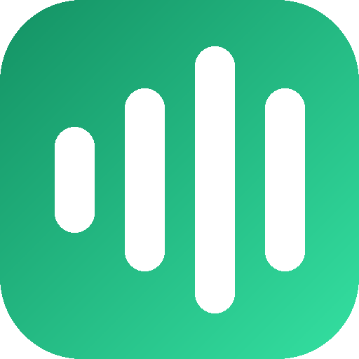

<div align="center">
  <a href="./README_EN.md">English</a> · <a href="./README.md">中文</a>

  

  <h1>RunBeat</h1>

  <b>把任何一首歌，变成你的跑步步频</b>

  <p>每一步踩在鼓点上 · 音高不变 · 变速只在本机进行</p>

  <a href="https://github.com/chenllsu/RunBeat/releases/latest"></a>
  <a href="LICENSE"></a>
  <a href="https://github.com/chenllsu/RunBeat"></a>

  <p><a href="https://github.com/chenllsu/RunBeat/releases/latest"><b>⬇ 下载 Windows 版（约 130 MB）</b></a></p>
</div>

---

## 为什么需要它

跑步听歌最扫兴的，是节奏和脚步打架。170–180 步/分钟是多数跑者的舒适区，但很少有歌正好是这个速度。

RunBeat 检测原曲速度，把整首歌均匀拉长或压短到你的目标步频——只动时间轴，不动音高，不重排鼓点。你听到的还是那首歌，只是每一步都踩在拍上。

> 第一首歌要等 1~2 分钟（后台编译音频引擎，一次性），之后每首约 1 秒。程序会在旁边建 `data/` 存文件，所以别放在 `C:\Program Files`；桌面、文档、D 盘都可以。

## 能做什么

| | |
|---|---|
| **🎯 按步频变速** | 自动测 BPM（含半速/倍速自动纠正），可一键切换候选值或手填；步频 120–220，1:1 / 1:2 两种踩法 |
| **✂️ 裁剪对拍** | 波形上拖选区，松手自动吸附最近鼓点；开头可渐入 |
| **👂 两级试听** | 浏览器实时变速零延迟；成品用服务端精确渲染，音质更好 |
| **📦 批量导出** | 一次处理最多 20 首，各自独立调参，打包成一个 zip |

还有一个「⌕ 搜歌下载」：直搜 Apple Music，先试听 30 秒再下载，下完自动进编辑流程。**变速全部在本机，不上传任何文件**；只有搜歌会访问 Apple Music（需有效订阅，凭证只存本机）。

## 上手

下载 zip → 解压 → 双击 `RunBeat.exe` → 拖一首歌进去 → 调步频 → 生成下载。

开发者从源码运行：

```bash
git clone https://github.com/chenllsu/RunBeat.git
cd RunBeat
python -m venv .venv
.venv/Scripts/python.exe -m pip install -r requirements.txt
.venv/Scripts/python.exe -m uvicorn app.main:app --host 127.0.0.1 --port 8000
```

打开 <http://127.0.0.1:8000>。ffmpeg 已自带，无需安装。

<details>
<summary>检测精度与已知局限</summary>

| 项目 | 结果 |
|---|---|
| BPM 检测（合成样本 100~184.6） | 误差全部 **0**（半速误判自动修回） |
| 真实歌曲 | 真值 99.4 → 读出 **99.0** |
| 变速时长 | 误差 < 0.1% |
| 导出成品节拍声落点 | 中位误差 **0 ms** |

- **量化误差**（良性 ±1.5%）：标准 128 BPM 会读成 126 或 129，对跑步影响 ±3 步，可接受
- **半速/倍速误判**（恶性）：已自动裁决；民谣、爵士等弱鼓点曲仍可能失手，用「听节拍对齐」核对
- 古典 / 现场 / 纯人声本来就没有唯一 BPM
- **别用 1:1 / 1:2 开关修检测错误**——检测错了就改数字

完整数据见 [docs/ARCHITECTURE.md](docs/ARCHITECTURE.md)。

</details>

<details>
<summary>HTTP 接口</summary>

| 方法 | 路径 | 说明 |
|---|---|---|
| POST | `/api/upload` · `/api/upload-many` | 上传（单/批量） |
| GET | `/api/waveform/{id}` · `/api/beats/{id}?bpm=` | 波形 / 拍点 |
| POST | `/api/export` · `/api/package` | 渲染成品 / 打包 zip |
| POST | `/api/apple/search` · `/api/apple/import` | 搜歌 / 下载任务 |
| GET/POST/DELETE | `/api/apple/cookies` · `/api/apple/wvd` · `/api/apple/settings` | 凭证 / CDM / 地区 |

</details>

## 项目结构

```
app/       后端：BPM 检测 · 时间伸缩 · 在线音源 · 缓存清理
static/    前端：原生 JS，无框架
scripts/   自检 · 前端校验 · 端到端测试
docs/      实现笔记、图标
data/      运行时生成，6 小时自动清理，删掉不影响程序
```

## 许可

**GPL-3.0**（因依赖 pywidevine）。在线音源基于 gamdl / amdl / yt-dlp，检测用 librosa，变速用 ffmpeg。

仅供个人学习研究，请勿分发或商用变速结果。本项目不存储任何版权内容，Apple Music 凭证由用户自行提供。
