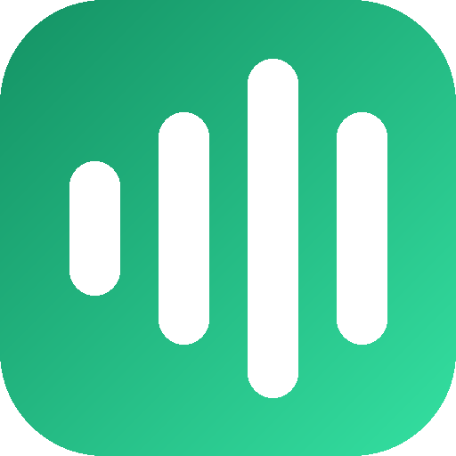

<div align="center">
  <a href="./README_EN.md">English</a> · <a href="./README.md">中文</a>

  

  <h1>RunBeat</h1>

  <b>Turn any song into your running cadence</b>

  <p>Every step lands on a beat · Pitch unchanged · All processing stays on your machine</p>

  <a href="https://github.com/chenllsu/RunBeat/releases/latest"></a>
  <a href="LICENSE"></a>
  <a href="https://github.com/chenllsu/RunBeat"></a>

  <p><a href="https://github.com/chenllsu/RunBeat/releases/latest"><b>⬇ Download for Windows (~130 MB)</b></a></p>
</div>

---

## Why

The most disappointing thing about running with music is when the beat fights your footsteps. 170–180 steps per minute is the comfort zone for most runners, yet few songs land exactly there.

RunBeat detects the song's tempo and stretches or compresses the whole track to your target cadence — only the timeline changes: no pitch shift, no re-arranged beats. It's still the same song, with every step on the beat.

> The first song takes 1–2 minutes (one-time audio engine compilation); every song after that takes ~1 second. The app creates `data/` next to itself, so avoid `C:\Program Files` — Desktop, Documents, or D:\ are all fine.

## What it does

| | |
|---|---|
| **🎯 Stretch to your cadence** | Auto-detects BPM (with half/double-speed correction); candidates one click away, or type your own. 120–220 spm, with 1:1 / 1:2 mappings |
| **✂️ Beat-snapped clipping** | Drag a range on the waveform; handles snap to the nearest drum hit on release; optional fade-in |
| **👂 Two-level audition** | Real-time in-browser stretching with zero latency; final renders use precise server-side processing |
| **📦 Batch export** | Up to 20 songs with independent settings, bundled into one zip |

There's also "⌕ Search & download": search Apple Music directly, audition 30 seconds before downloading, then the song flows straight into the editor. **All stretching runs locally — nothing is uploaded.** Only search contacts Apple Music (active subscription required; credentials stay on this machine).

## Get started

Download the zip → extract → run `RunBeat.exe` → drag a song in → set cadence → generate & download.

From source:

```bash
git clone https://github.com/chenllsu/RunBeat.git
cd RunBeat
python -m venv .venv
.venv/Scripts/python.exe -m pip install -r requirements.txt
.venv/Scripts/python.exe -m uvicorn app.main:app --host 127.0.0.1 --port 8000
```

Open <http://127.0.0.1:8000>. ffmpeg is bundled — no installation needed.

<details>
<summary>Detection accuracy & known limits</summary>

| Item | Result |
|---|---|
| BPM detection (synthetic 100–184.6) | Error **0** across the board (half-speed auto-corrected) |
| Real song | Ground truth 99.4 → reads **99.0** |
| Stretch duration | Error < 0.1% |
| Click placement in exported file | Median error **0 ms** |

- **Quantization error** (benign, ±1.5%): a 128 BPM song reads as 126 or 129 — ±3 spm for running, acceptable
- **Half/double-speed misjudgment** (malignant): auto-adjudicated; folk and jazz with weak drums can still slip — verify with "Beat alignment"
- Classical / live / a cappella music has no single BPM to begin with
- **Don't use the 1:1 / 1:2 switch to fix detection errors** — change the number instead

Full data: [docs/ARCHITECTURE.md](docs/ARCHITECTURE.md).

</details>

<details>
<summary>HTTP API</summary>

| Method | Path | Description |
|---|---|---|
| POST | `/api/upload` · `/api/upload-many` | Upload (single/batch) |
| GET | `/api/waveform/{id}` · `/api/beats/{id}?bpm=` | Waveform / beats |
| POST | `/api/export` · `/api/package` | Render result / bundle zip |
| POST | `/api/apple/search` · `/api/apple/import` | Search / download task |
| GET/POST/DELETE | `/api/apple/cookies` · `/api/apple/wvd` · `/api/apple/settings` | Credentials / CDM / region |

</details>

## Project structure

```
app/       Backend: BPM detection · time-stretch · online source · cache cleanup
static/    Frontend: vanilla JS, no framework
scripts/   Self-checks · frontend validation · end-to-end tests
docs/      Implementation notes, icon assets
data/      Runtime-generated, auto-cleaned after 6 hours; safe to delete
```

## License

**GPL-3.0** (required by the pywidevine dependency). The online source builds on gamdl / amdl / yt-dlp, detection uses librosa, stretching uses ffmpeg.

For personal study and research only — don't distribute or commercialize the results. This project stores no copyrighted content; Apple Music credentials are provided by the user.
